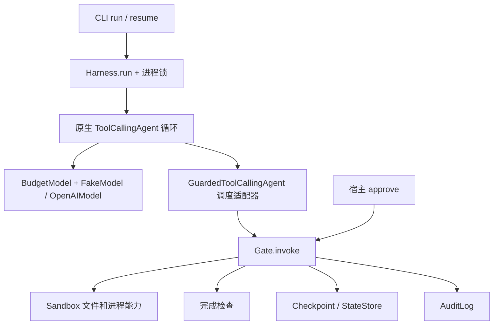
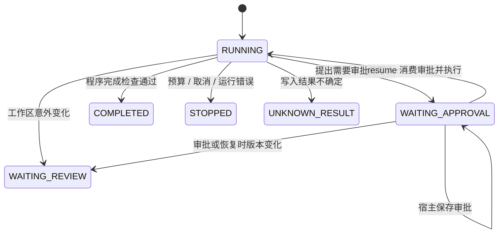

# Guarded Coding Harness

基于 `smolagents==1.26.0` 的可恢复编码 Agent，为 `ToolCallingAgent` 增加工具门禁、受限文件与进程能力、持久化状态、人工审批、审计和完成检查。模型负责规划和选择工具，宿主程序决定是否执行及是否完成。

支持两类任务：

| `--kind` | 任务 | 必需交付物 | 完成约束 |
| --- | --- | --- | --- |
| `code_understanding` | 阅读代码、解释行为和测试覆盖 | `artifacts/analysis.md` | 保持源码清单不变；当前版本测试成功 |
| `test_fix` | 根据测试失败修复源码 | `artifacts/repair.md` | 存在源码清单变化；当前版本测试成功 |

报告写入也需要审批。模型仅返回“完成”不会进入 `COMPLETED`；程序还检查计划、阅读记录、已批准报告的内容摘要、当前版本测试证据及未解决动作。

本文集中提供运行说明、架构设计、实际验收结果和人工复查步骤。验收证据保存在 [output/acceptance/](output/acceptance/)。

- [安装与测试](#安装与测试)
- [离线审批与恢复演示](#离线走通审批与恢复)
- [真实模型配置](#使用真实模型)
- [架构与恢复语义](#architecture)
- [作业三验收报告](#acceptance-report)
- [人工验收手册](#acceptance-manual)

## 安装与测试

使用 Python 3.12 或更新版本。文件锁、目录文件描述符和进程组管理依赖 POSIX，运行环境为 macOS/Linux。

```bash
python3.12 -m venv .venv
.venv/bin/python -m pip install -r requirements-lock.txt
.venv/bin/python -m pip install -e . --no-deps
.venv/bin/python -m pytest -q
```

`requirements-lock.txt` 固定本项目验收使用的依赖版本。后续命令均在仓库根目录执行，也可将 `.venv/bin/guarded-harness` 换为 `.venv/bin/python -m guarded_harness.cli`。

一键重跑完整测试、两类离线任务和跨进程审批恢复，并生成新的验收证据目录：

```bash
.venv/bin/python scripts/run_acceptance.py
```

预期退出码为 0，输出 `"passed": true`。真实模型验收使用下方独立流程，证据范围见验收手册。

提交目录仅保留上述一份完整离线验收记录。`.gitignore` 会忽略新的演示/重复运行目录、运行锁及缓存；需要提交新一轮证据时，应显式选取对应目录。`.venv/` 是本机依赖环境，不纳入提交。

## 离线走通审批与恢复

`FakeModel` 只提供确定性的模型决策，实际工具仍经过 Gate、Sandbox、Checkpoint 与 Audit。下面以代码理解任务为例，复制受信示例到独立工作区，保留原示例用于重复复查。

每次演示请使用新的目录；已存在 Checkpoint 的 `run-dir` 不能再次执行 `run`。

```bash
mkdir -p output/manual-demo
cp -R examples/understand output/manual-demo/workspace
cat > output/manual-demo/actions-start.json <<'JSON'
[
  {"id":"plan-1","name":"plan_task","arguments":{"steps":["阅读源码与测试","编写分析报告","运行测试并完成检查"]}},
  {"id":"read-source-1","name":"read_file","arguments":{"path":"calculator.py"}},
  {"id":"read-tests-1","name":"read_file","arguments":{"path":"test_calculator.py"}},
  {"id":"report-1","name":"write_file","arguments":{"path":"artifacts/analysis.md","content":"# 代码分析\n\ncalculator.py 提供 add 和 divide。add 返回两数之和；divide 返回商，分母为零时抛出 ValueError。测试覆盖正负数加法、普通除法及零分母异常。此次任务仅新增分析报告，保持原有源码与测试不变。\n"}}
]
JSON

.venv/bin/guarded-harness run \
  --workspace output/manual-demo/workspace \
  --run-dir output/manual-demo/run \
  --kind code_understanding \
  --task '阅读计算模块，解释行为和测试覆盖，生成分析报告并执行测试' \
  --model fake --actions output/manual-demo/actions-start.json
```

此时预期为 `WAITING_APPROVAL`，退出码为 `2`。报告尚未写入。查看 `pending.arguments` 的完整目标路径和内容，确认本次写入后，以实际复核人的标识审批：

```bash
.venv/bin/guarded-harness inspect --run-dir output/manual-demo/run
.venv/bin/guarded-harness approve \
  --run-dir output/manual-demo/run --call-id report-1 --actor reviewer
```

`approve` 仅保存审批，不执行写入。新进程 `resume` 先执行这一笔已经批准的待执行动作，再让模型继续决策。FakeModel 本身没有持久化动作游标，所以恢复时提供剩余动作，不重新提供已经完成的动作：

```bash
cat > output/manual-demo/actions-resume.json <<'JSON'
[
  {"id":"test-1","name":"run_test","arguments":{"command":"unit"}},
  {"id":"finish-1","name":"final_answer","arguments":{"answer":"分析报告已生成，源码与测试保持不变，当前工作区测试通过。"}}
]
JSON

.venv/bin/guarded-harness resume \
  --run-dir output/manual-demo/run \
  --model fake --actions output/manual-demo/actions-resume.json
.venv/bin/guarded-harness inspect --run-dir output/manual-demo/run
.venv/bin/guarded-harness verify-audit --run-dir output/manual-demo/run
```

`run` 和 `resume` 的退出码：`0` 表示程序完成检查通过，`2` 表示等待审批，`1` 表示停止或错误。应同时检查输出的 `status` 和 `stop_reason`。`verify-audit` 的 `0` 只表示现有日志链校验通过，不表示任务完成。

测试修复任务使用 `examples/fix` 的副本及 `--kind test_fix`。模型应阅读失败测试，修复 `calculator.py` 中错误的 `add`，写入 `artifacts/repair.md`，再运行测试。源码修改和报告写入分别审批；每次出现 `WAITING_APPROVAL`，都使用对应的 `pending.tool_call_id`。

## FakeModel 动作格式

动作文件为 JSON 数组，每个元素代表一次模型响应：

```json
[
  {"id":"unique-call-id","name":"read_file","arguments":{"path":"calculator.py"}}
]
```

`id` 是本次运行内唯一的工具调用 ID，`arguments` 必须是对象且字段恰好匹配工具声明。

| 工具 | 参数 |
| --- | --- |
| `plan_task` | `{"steps":["非空步骤"]}` |
| `list_files` | `{}` |
| `read_file` | `{"path":"相对路径"}` |
| `write_file` | `{"path":"相对路径","content":"完整替换内容"}` |
| `run_test` | `{"command":"unit"}` |
| `final_answer` | `{"answer":"总结"}` |

一轮只能提交一个工具调用。测试可使用嵌套动作数组构造多调用错误场景，生产流程应遵守单调用约束。动作耗尽时 FakeModel 会提出默认 `final_answer`，它仍须通过相同的完成检查。

## 使用真实模型

真实模型通过 `smolagents.OpenAIModel` 访问显式配置的 OpenAI 兼容端点。运行前在当前进程环境中设置 `OPENAI_API_KEY`、`OPENAI_BASE_URL`、`OPENAI_MODEL_NAME`。程序直接读取环境变量，不依赖自动加载仓库中的 `.env` 文件；不要把密钥写入动作文件或提交到仓库。

```bash
.venv/bin/guarded-harness run \
  --workspace output/your-task/workspace \
  --run-dir output/your-task/run \
  --kind test_fix \
  --task '修复现有失败测试对应的源码问题，保持测试不变，输出修复报告' \
  --model real --max-steps 20 --max-calls 40

.venv/bin/guarded-harness inspect --run-dir output/your-task/run
.venv/bin/guarded-harness approve \
  --run-dir output/your-task/run --call-id CALL_ID --actor reviewer
.venv/bin/guarded-harness resume --run-dir output/your-task/run --model real
```

先准备实际工作区，将 `CALL_ID` 替换为待审批调用 ID。使用 `api.deepseek.com` 时，适配器显式禁用 thinking，以兼容 smolagents 的 `tool_choice=required`，依据见 [DeepSeek API 文档](https://api-docs.deepseek.com/api/create-chat-completion/)。实际模型覆盖范围见[验收报告](#acceptance-report)，复查步骤见[人工验收手册](#acceptance-manual)。

## 状态与证据

运行目录必须在工作区之外；两者可以是同一父目录下的兄弟目录。每个 run 保存：

```text
workspace/
  artifacts/analysis.md 或 artifacts/repair.md
run/
  checkpoint.json   # 状态、计划、步数、预算、审批、证据、已完成调用和策略
  audit.jsonl       # 按 run_id / tool_call_id 关联的追加审计日志
  baseline.json     # 启动时可读文本文件的基线
  changes.patch     # 完成检查生成的文本差异
  diff.json         # 前后源码清单及 changed_files
```

`changes.patch` 和 `diff.json` 在完成检查阶段生成，出现这些文件不应单独视为完成证明，还需检查 Checkpoint 的终态及对应审计结果。源码清单排除交付物和常见生成目录；审批与测试版本指纹包含 `artifacts`。

`UNKNOWN_RESULT` 表示写入意图已经持久化，但没有可确认的执行结果；`WAITING_REVIEW` 表示恢复或执行时发现工作区变化。这两种状态都停止自动执行。人工核对文件、审计和 Checkpoint 后，在确认后的工作区创建新 run；当前实现不提供强制恢复或自动重放功能。因预算、取消或运行错误进入 `STOPPED` 的任务同样不会被 `resume` 自动重启。

<a id="security-boundary"></a>

## 安全边界

文件路径、符号链接、硬链接、敏感目录、命令白名单、环境变量、输出大小、超时和取消都由程序检查。默认 pytest 使用隔离导入、显式配置及禁用插件自动发现；测试文件、配置和 pytest 入口保护规则阻止模型用替换测试来制造成功。

这些是本地文件与进程的能力限制，**不是操作系统沙箱**。配置的命令以及测试执行的仓库代码必须可信，它们仍使用当前用户的操作系统权限。项目示例与验收采用受信的小型本地仓库；没有运行不可信公网仓库。应用到不可信代码时需要额外的容器、虚拟机或操作系统隔离。

审计会递归脱敏常见凭据字段以及 Bearer / `sk-` 凭据串，使用 SHA-256 链检测普通记录改写、乱序、中间删除和不完整尾记录。没有外部信任锚点或签名，因此不能证明整条日志未被重新计算，也不能检测删除完整尾记录后的有效前缀；不要将 `verify-audit` 解释为抵抗管理员篡改的证明。

<a id="architecture"></a>

## 架构与恢复语义

本项目围绕原生 `smolagents.ToolCallingAgent` 组合控制组件。模型继续决定计划、工具及参数，smolagents 继续负责模型调用、ReAct 迭代、工具结果进入记忆和最终响应处理。程序只在调度边界控制副作用，并独立判断任务是否完成。



### 组件职责与扩展点

| 文件 | 责任 |
| --- | --- |
| `gate.py` | 工具调用唯一业务调度入口；校验参数、预算、重复动作、权限、边界、审批和版本；记录执行证据 |
| `sandbox.py` | 限制文件访问与命令调用；生成源码清单和工作区指纹；管理超时、取消及输出上限 |
| `state_store.py` | 定义 `RunState`；验证结构；原子且持久地保存 JSON |
| `checkpoint.py` | 固定 `checkpoint.json`；提供运行级跨进程锁；记录保存事件 |
| `audit.py` | 锁内追加 JSONL、脱敏、序号和哈希链验证 |
| `harness.py` | 组装模型与工具、接入上游调度、恢复状态、控制预算、进行最终验收 |
| `models.py` | 确定性 FakeModel 和显式配置的真实模型适配 |
| `cli.py` | 提供 run / inspect / approve / resume / verify-audit 操作 |

`GuardedToolCallingAgent` 只扩展两个调度方法：

1. `process_tool_calls` 要求每轮一个调用，并在上游将空参数值转换为 `{}` 之前校验原始参数对象，随后交回上游实现。
2. `execute_tool_call` 把调用 ID、名称及参数送入 Gate。被拒绝的 `final_answer` 转换为上游可处理的 `AgentToolCallError`，避免上游把普通工具返回值当作完成。

工具对象 `ToolSchema` 只向模型声明接口，`forward` 不执行实际业务逻辑。模型不能调用审批接口。项目未复制或改写 smolagents 的核心 ReAct 循环；`HarnessStop` 用于将宿主的确定性停止决定传播到外层，避免被当成可重试工具错误。

接口行为以锁定版本和本仓库测试为准；上游说明见 [smolagents Agents 文档](https://huggingface.co/docs/smolagents/reference/agents)。升级依赖后应重新验证这两个扩展点及最终回答处理。

### 一次工具调用

Gate 在执行 handler 前依次检查调用 ID、运行状态、调用预算、工具名称、精确参数结构、连续重复动作、能力权限和工作区指纹。随后调用 Sandbox 做路径或命令预检，再处理写入审批。

默认能力为 `read`、`write`、`test`。`plan_task`、`list_files`、`read_file`、`final_answer` 使用 `read`；文件写入使用 `write`；测试执行使用 `test`。同一工具与参数连续出现三次时，第三次执行前返回 `REPEATED_ACTION`。已经完成的调用 ID 再次提交时返回 `DUPLICATE_CALL`。

拒绝结果使用统一结构：

```json
{
  "ok": false,
  "error": {"code": "INVALID_ARGUMENTS", "message": "具体原因"},
  "tool_call_id": "call-id"
}
```

普通校验失败不会进入业务 handler。需要等待审批、工作区变化、预算耗尽等状态转换会保存 Checkpoint 并中止当前运行；它们不是普通的可重试工具输出。

写入完成后清除旧测试证据。非写入工具前后若工作区指纹变化，清除证据及审批并进入 `WAITING_REVIEW`，防止把测试期间发生变化后的版本当作已测试版本。

### 审批与状态转换



写入的 `pending` 保存调用 ID、工具名称、完整参数、参数签名及工作区指纹。`approve` 必须提供当前待审批调用 ID 和非空 actor，审批绑定 `run_id`、签名和版本，并带有一次性 `used` 标记。审批不会立即执行文件写入。

恢复时只有等待审批且已有匹配审批的调用会继续执行。执行前将审批置为已使用，清除 `pending`，写入 `inflight` 并持久化，再进入 handler。成功之后保存证据、完成调用 ID 和结果，最后清除 `inflight`。重复调用、不同参数或不同版本不能复用这笔审批。

actor 是操作者提供的审计标识，不是身份认证系统。生产部署如需可信人员身份及授权角色，应由外层认证接口提供，不能只信任命令行字符串。

### Checkpoint 和崩溃窗口

`RunState` 保存运行 ID、任务类型、工作区及版本、计划、步数与调用数、预算上限、证据、审批、待执行动作、执行中动作、已完成调用、历史、停止原因、基线清单、最终答案和运行策略。

保存采用同目录临时文件、文件 fsync、原子 replace、目录 fsync。状态文件位于工作区外，权限为 `0600`。数据文件锁避免并发读写读到半个 JSON；独立的非阻塞运行锁覆盖 `run` / `approve` 等宿主操作，另一个进程不能同时使用同一 run。

| 中断位置 | 恢复行为 |
| --- | --- |
| 一个安全步骤已持久化，状态仍为 RUNNING | 校验策略和版本后继续，保留历史、预算和已完成调用 |
| WAITING_APPROVAL，尚无审批 | 保持等待，不写文件 |
| 已审批，执行意图尚未持久化 | 恢复后执行唯一待审批动作 |
| `inflight` 已持久化，结果尚未持久化 | 标记 UNKNOWN_RESULT，不自动重放；即使实际写入尚未发生也采取保守停止 |
| 写入结果和已完成调用已持久化 | 保留结果，拒绝同一调用 ID 再次执行 |
| 无未决写入，但工作区版本变化 | 清除旧证据与旧审批，进入 WAITING_REVIEW |

恢复检查同时比较工作区路径、任务类型和运行策略。命令白名单、超时、输出上限、权限及交付物路径均在策略中固定。CLI 从 Checkpoint 读取原策略，避免新进程无意改变边界。当前代码使用新的 smolagents 内存实例，把已持久化计划、历史、证据和完成调用 ID 作为恢复上下文提供给模型；不是保存并反序列化整个 Agent 对象。

`UNKNOWN_RESULT` 和 `WAITING_REVIEW` 必须由人工核对当前文件、审计与 Checkpoint，再以确认后的工作区创建新 run。没有强行 resume、清空计数或自动重放未知写入的入口。`STOPPED` 与 `COMPLETED` 也不会被 `resume` 自动改回 RUNNING。

### 预算、取消和命令边界

默认上限为 20 个模型步骤、40 次工具尝试。`BudgetModel` 在真实模型请求之前检查并持久化步数，Gate 在工具调用前检查调用预算。已经计数的待审批调用恢复执行时不重复计数；新进程沿用原计数和上限。预算耗尽时保存明确停止原因，不能以模型兜底回答代替程序验收。

`run_test` 只接受配置中的命令别名，默认别名为 `unit`。命令使用参数数组及 `shell=False`，不接受模型提交任意 shell 文本。默认 pytest 使用 `python -I -B -m pytest` 加显式配置，隔离加载 pytest、禁止生成字节码，再为项目源码设置导入路径；禁用插件自动发现，避免通过 workspace 中同名 pytest 模块劫持测试入口。

测试进程只获得白名单环境变量。输出默认最多 32 KiB，超时默认 10 秒。超时或取消时终止整个进程组，并回收进程；输出截断会在结果里标记。凭据不会通过常规环境变量自动传给测试进程。

这些检查的执行权限和信任范围见[安全边界](#security-boundary)。

### 最终验收与证据关联

完成检查要求非空最终回答、已记录计划、阅读证据、没有待审批或未决执行，以及符合当前内容摘要的已批准报告。报告去除首尾空白后至少有 40 个字符，但这一长度门槛不能代替人工判断报告质量。

测试证据必须成功退出、没有超时或取消，且指纹与当前工作区一致。代码理解任务要求源码清单不变；测试修复任务要求清单存在变化。`manifest()` 用于源码差异并排除 `artifacts` 和常见生成目录，`fingerprint()` 包含 `artifacts`，因此修改交付物也会影响审批与测试版本。

最终生成 `changes.patch` 和 `diff.json`，完成结果关联当前工作区指纹、交付物路径及使用的测试调用 ID。文本 diff 来自可读文本基线；二进制、敏感或超出读取上限的文件仍由清单摘要覆盖，不能依靠文本 patch 还原其完整内容。

审计以 `run_id` 关联一次运行，以 `tool_call_id` / `toolCallId` 关联 Gate、Sandbox、审批、执行和结果。每条记录包含时间、actor、event、decision、rule、details、seq、prev_hash 和 hash。Checkpoint 保存事件仅记录状态与计数，不复制完整待执行参数。

日志在跨进程文件锁内追加并 fsync。读取和追加前验证现有链，发现损坏后拒绝继续追加。脱敏规则及哈希链的证明范围见[安全边界](#security-boundary)。

<a id="acceptance-report"></a>

## 作业三验收报告

验收日期：2026-10-17。当前提交保留一份完整离线验收记录：**115 项测试与 11 个子测试通过**，代码理解、测试修复和跨进程恢复均完成。该记录包含 G1–H3 的确定性测试及 T1 全套结果。

此前真实模型代码理解任务曾完成，但本次提交整理开始时，其原始证据目录已不在工作区。当前离线记录不能代替 T2 的真实模型证据；提交前如需复核 T2，应补回原始记录或按[真实模型复查步骤](#real-model-review)重新运行。

### 实际结果

| 检查 | 结果 | 原始证据 |
| --- | --- | --- |
| 完整验收脚本中的 pytest | 115 passed, 11 subtests passed in 14.90s | [pytest.txt](output/acceptance/20261017T054103830010Z-804bf0f3/pytest.txt) |
| 离线代码理解 | COMPLETED；6 步/6 次调用；报告写入 1 次；源码无变化；示例测试 3 passed | [summary.json](output/acceptance/20261017T054103830010Z-804bf0f3/summary.json) |
| 离线测试修复 | COMPLETED；8 步/8 次调用；源码和报告各写入 1 次；原失败测试修复后 3 passed | [完整运行记录](output/acceptance/20261017T054103830010Z-804bf0f3/transcript.json) |
| 跨进程审批与恢复 | 预算与已执行调用保留；批准的写入各执行 1 次 | [recovery.json](output/acceptance/20261017T054103830010Z-804bf0f3/recovery.json) |
| 真实模型代码理解（T2） | 历史已完成，当前提交未附原始证据 | [需补充证据或复现](#real-model-review) |
| 审计校验 | 离线代码理解 71 条、测试修复 100 条，链校验均通过 | 各 run 的 `audit.jsonl` |
| 依赖完整性 | `pip check`：No broken requirements found | 固定依赖见 [requirements-lock.txt](requirements-lock.txt) |

环境为 Python 3.12.15、macOS 26.5.2 arm64、smolagents 1.26.0、pytest 9.1.1。未提交或推送 Git 变更。

### 完整任务与证据关联

代码理解 run ID：`c71e5088e6894853b20eb2ce62ed6b6e`。报告为 [analysis.md](output/acceptance/20261017T054103830010Z-804bf0f3/code_understanding/workspace/artifacts/analysis.md)，[源码差异清单](output/acceptance/20261017T054103830010Z-804bf0f3/code_understanding/run/diff.json) 的 `changed_files` 为空；这符合代码理解任务不改源码的要求。

测试修复 run ID：`9b3b6a3d26e043c4975f4381af273cc9`。初始 `add` 错误地执行减法，基线测试退出码为 1；批准后修复为加法，测试文件内容保持不变。查看 [changes.patch](output/acceptance/20261017T054103830010Z-804bf0f3/test_fix/run/changes.patch)、[repair.md](output/acceptance/20261017T054103830010Z-804bf0f3/test_fix/workspace/artifacts/repair.md) 和 [审计](output/acceptance/20261017T054103830010Z-804bf0f3/test_fix/run/audit.jsonl)。旧失败测试记录保留在审计中，最终状态仅保留当前有效测试证据。

真实模型任务的历史结果不作为当前提交的可核验附件；当前保留的审计和 Checkpoint 均来自上述离线验收，内容未被改写。

### 关键故障验收

- C2 实际在写入成功后调用 `os._exit(86)`，新进程恢复为 `UNKNOWN_RESULT`，没有重写文件。
- C3 使用独立 Python 进程继续运行，断点前后步数/调用数从 4/4 延续到 7/7；已完成写入的 mtime 不变，审计仅有一次执行。
- S4 实际创建父子进程，超时和取消后进程组终止，延迟副作用未发生。
- G1/G2/G4 直接检查 handler 次数：非法参数为 0，第三次重复动作前共执行 2 次，已批准调用重复提交仍只写 1 次。
- H2 同时覆盖“通过测试后写源码”和“测试/完成检查期间源码变化”，旧结果不能支持完成。

逐项测试映射与人工操作见 [验收手册](#acceptance-manual)。

### 验收范围

本地路径、进程、审批、恢复与完成门禁已按题目验收；执行的是受信的小型示例仓库。当前实现不提供操作系统级隔离，测试代码仍有当前用户权限；不把本结果解释为可安全执行任意恶意仓库。审计哈希链没有外部签名或信任锚点。普通 CLI 审批的 actor 是审计标识，外部身份认证不在本作业范围内。

<a id="acceptance-manual"></a>

## 作业三人工验收手册

本手册的离线基线为 **115 项测试与 11 个子测试通过**，当前提交包含两类完整离线任务的证据。真实模型任务的原始证据待补充，复现流程见第 6 节。实际结果、环境与范围见 [验收报告](#acceptance-report)。

### 1. 准备环境

先按[安装与测试](#安装与测试)准备环境，再执行：

```bash
.venv/bin/python -m pip check
.venv/bin/pytest -q
```

预期无依赖冲突，`pytest` 退出码为 0，输出 `115 passed, 11 subtests passed`；耗时不要求相同。不需要真实模型凭据，测试只使用 FakeModel、受信脚本和本地独立进程。

本次原始结果：[pytest.txt](output/acceptance/20261017T054103830010Z-804bf0f3/pytest.txt)。六个题目指定测试文件位于 [tests/](tests/)，另有 CLI 与真实跨进程恢复测试。

### 2. 一键复现两类完整任务

```bash
.venv/bin/python scripts/run_acceptance.py
```

脚本先运行完整 pytest，再复制两个示例仓库到新的 `output/acceptance/<时间戳>/` 下，通过独立 CLI 进程执行 run、inspect、approve、resume 和 verify-audit。预期终端返回 `"passed": true`，进程退出码为 0。记下输出中的目录。

脚本中的审批仅针对它刚创建的示例副本，并精确核对预定义调用 ID、路径、文件内容和原文件快照；普通 CLI 没有自动批准功能。脚本拒绝覆盖已有非空输出目录。

本次完整证据位于 [本次保留的验收目录](output/acceptance/20261017T054103830010Z-804bf0f3/)：

| 文件 | 人工复查内容 |
| --- | --- |
| [summary.json](output/acceptance/20261017T054103830010Z-804bf0f3/summary.json) | 总 `passed=true`；两类任务各项 checks 全为 true |
| [transcript.json](output/acceptance/20261017T054103830010Z-804bf0f3/transcript.json) | 每个命令的参数、退出码、stdout/stderr 和耗时；实际码与 expected_returncode 一致 |
| [recovery.json](output/acceptance/20261017T054103830010Z-804bf0f3/recovery.json) | 审批不重置计数；恢复后完成调用集合保留；每笔写入只增加一次 |
| [修复前后差异](output/acceptance/20261017T054103830010Z-804bf0f3/test_fix/run/changes.patch) | `left - right` 修复为 `left + right`；测试文件无改动 |
| [代码理解报告](output/acceptance/20261017T054103830010Z-804bf0f3/code_understanding/workspace/artifacts/analysis.md) | 对照源码核对函数行为及测试覆盖 |
| [测试修复报告](output/acceptance/20261017T054103830010Z-804bf0f3/test_fix/workspace/artifacts/repair.md) | 对照失败断言、修改原因及通过测试核对结论 |

`transcript.json` 较长，可搜索 `fix-test-before` 查看初始失败，搜索 `fix-test-final` 查看最终通过。Checkpoint 中旧测试证据会被修改操作清除；历史事实保留在审计和运行记录中。

### 3. 手动复查审批、执行与恢复

以下命令在 `week3` 目录、同一个 Bash/Zsh 终端中依次执行，不需要真实模型凭据。每次从准备步骤开始都会创建独立目录，不覆盖已交付的验收证据。遇到非预期退出码或 Python 断言失败时，停止并检查输出。

#### 3.0 准备工作区和两阶段动作

```bash
mkdir -p output
MANUAL_DEMO_DIR="$(mktemp -d "$PWD/output/manual-review.XXXXXX")"
export MANUAL_DEMO_DIR
cp -R examples/understand "$MANUAL_DEMO_DIR/workspace"

cat > "$MANUAL_DEMO_DIR/actions-start.json" <<'JSON'
[
  {"id":"plan-1","name":"plan_task","arguments":{"steps":["阅读源码与测试","编写分析报告","运行测试并完成检查"]}},
  {"id":"read-source-1","name":"read_file","arguments":{"path":"calculator.py"}},
  {"id":"read-tests-1","name":"read_file","arguments":{"path":"test_calculator.py"}},
  {"id":"report-1","name":"write_file","arguments":{"path":"artifacts/analysis.md","content":"# 代码分析\n\ncalculator.py 提供 add 和 divide。add 返回两数之和；divide 返回商，分母为零时抛出 ValueError。测试覆盖正负数加法、普通除法及零分母异常。此次任务仅新增分析报告，保持原有源码与测试不变。\n"}}
]
JSON

cat > "$MANUAL_DEMO_DIR/actions-resume.json" <<'JSON'
[
  {"id":"test-1","name":"run_test","arguments":{"command":"unit"}},
  {"id":"finish-1","name":"final_answer","arguments":{"answer":"分析报告已生成，源码与测试保持不变，当前工作区测试通过。"}}
]
JSON

printf '本次人工验收目录：%s\n' "$MANUAL_DEMO_DIR"
ls "$MANUAL_DEMO_DIR/workspace"
```

预期工作区包含 `calculator.py` 和 `test_calculator.py`。动作文件、命令输出和 run 目录都放在工作区之外，避免验收记录本身改变工作区指纹。后续命令继续使用这里设置的 `MANUAL_DEMO_DIR`。

#### 3.1 首次运行：确认等待审批且没有写入

```bash
if .venv/bin/guarded-harness run \
  --workspace "$MANUAL_DEMO_DIR/workspace" \
  --run-dir "$MANUAL_DEMO_DIR/run" \
  --kind code_understanding \
  --task '阅读计算模块，解释行为和测试覆盖，生成分析报告并执行测试' \
  --model fake --actions "$MANUAL_DEMO_DIR/actions-start.json" \
  > "$MANUAL_DEMO_DIR/run-result.json"; then
  MANUAL_RUN_RC=0
else
  MANUAL_RUN_RC=$?
fi

cat "$MANUAL_DEMO_DIR/run-result.json"
.venv/bin/python - "$MANUAL_RUN_RC" <<'PY'
import json, os, sys
from pathlib import Path
root = Path(os.environ['MANUAL_DEMO_DIR'])
state = json.loads((root / 'run-result.json').read_text())
assert int(sys.argv[1]) == 2, f'预期退出码 2，实际为 {sys.argv[1]}'
assert state['status'] == 'WAITING_APPROVAL'
assert state['stop_reason'] == 'APPROVAL_REQUIRED'
assert (state['step'], state['calls']) == (4, 4)
assert not (root / 'workspace/artifacts/analysis.md').exists()
print('PASS：退出码 2，等待审批，计数 4/4，报告尚未写入')
PY
```

`run` 的退出码 **2 是此步骤的预期结果**，不代表故障；不能将它改写成成功完成。

#### 3.2 查看待审批动作：核对路径、内容、签名和版本

```bash
.venv/bin/guarded-harness inspect --run-dir "$MANUAL_DEMO_DIR/run" \
  > "$MANUAL_DEMO_DIR/before-approval.json"

.venv/bin/python - <<'PY'
import json, os
from pathlib import Path
root = Path(os.environ['MANUAL_DEMO_DIR'])
state = json.loads((root / 'before-approval.json').read_text())
pending = state['pending']
expected = json.loads((root / 'actions-start.json').read_text())[-1]
assert state['status'] == 'WAITING_APPROVAL'
assert pending['tool_call_id'] == expected['id'] == 'report-1'
assert pending['name'] == expected['name'] == 'write_file'
assert pending['arguments'] == expected['arguments']
assert pending['workspace_hash'] == state['workspace_hash']
assert pending['signature']
assert state['approvals'] == {}
print(json.dumps(pending, ensure_ascii=False, indent=2))
print('PASS：待审批动作与提案一致，当前尚无审批')
PY
```

人工阅读输出中的 `arguments.path` 和 `arguments.content`，确认目标为 `artifacts/analysis.md` 且内容符合任务。只有同意这笔具体写入后，才继续下一步。

#### 3.3 批准：确认审批不执行写入、不消耗预算

以下命令以当前系统用户名作为审计 actor；需要使用指定复核人时，将 `"$(id -un)"` 替换为其标识。

```bash
.venv/bin/guarded-harness approve \
  --run-dir "$MANUAL_DEMO_DIR/run" --call-id report-1 --actor "$(id -un)" \
  > "$MANUAL_DEMO_DIR/approve-result.json"
.venv/bin/guarded-harness inspect --run-dir "$MANUAL_DEMO_DIR/run" \
  > "$MANUAL_DEMO_DIR/after-approval.json"

.venv/bin/python - <<'PY'
import json, os
from pathlib import Path
root = Path(os.environ['MANUAL_DEMO_DIR'])
before = json.loads((root / 'before-approval.json').read_text())
after = json.loads((root / 'after-approval.json').read_text())
assert after['status'] == 'WAITING_APPROVAL'
assert after['pending'] == before['pending']
assert (after['step'], after['calls']) == (before['step'], before['calls']) == (4, 4)
approval = after['approvals']['report-1']
assert approval['used'] is False
assert approval['signature'] == before['pending']['signature']
assert approval['workspace_hash'] == before['workspace_hash']
assert approval['run_id'] == before['run_id']
assert not (root / 'workspace/artifacts/analysis.md').exists()
print('PASS：审批已保存但未消费，计数仍为 4/4，报告尚未写入')
PY
```

`approve` 预期退出码为 0，但状态仍为 `WAITING_APPROVAL`；文件写入只会在 `resume` 时执行。

#### 3.4 新进程恢复：确认完成状态和计数延续

```bash
.venv/bin/guarded-harness resume \
  --run-dir "$MANUAL_DEMO_DIR/run" \
  --model fake --actions "$MANUAL_DEMO_DIR/actions-resume.json" \
  > "$MANUAL_DEMO_DIR/resume-result.json"
.venv/bin/guarded-harness inspect --run-dir "$MANUAL_DEMO_DIR/run" \
  > "$MANUAL_DEMO_DIR/completed-state.json"

.venv/bin/python - <<'PY'
import json, os
from pathlib import Path
root = Path(os.environ['MANUAL_DEMO_DIR'])
before = json.loads((root / 'before-approval.json').read_text())
state = json.loads((root / 'completed-state.json').read_text())
expected_report = json.loads((root / 'actions-start.json').read_text())[-1]['arguments']['content']
assert state['run_id'] == before['run_id']
assert state['status'] == state['stop_reason'] == 'COMPLETED'
assert state['pending'] is None and state['inflight'] is None
assert (state['step'], state['calls']) == (before['step'] + 2, before['calls'] + 2) == (6, 6)
assert set(before['executed']) <= set(state['executed'])
assert state['approvals']['report-1']['used'] is True
assert state['executed']['report-1']['tool'] == 'write_file'
assert (root / 'workspace/artifacts/analysis.md').read_text() == expected_report
assert json.loads((root / 'run/diff.json').read_text())['changed_files'] == []
tests = [e for e in state['evidence'] if e.get('tool') == 'run_test']
assert len(tests) == 1 and tests[0]['exit_code'] == 0
assert not tests[0]['timed_out'] and not tests[0]['cancelled']
assert tests[0]['workspace_hash'] == state['workspace_hash']
print(tests[0]['output'])
print('PASS：COMPLETED，计数 4/4 延续到 6/6，源码未变，当前版本测试通过')
PY

cat "$MANUAL_DEMO_DIR/workspace/artifacts/analysis.md"
```

`resume` 预期退出码为 0，示例测试为 `3 passed`。批准的待执行写入不会重复消耗步骤/调用预算，新增的两步来自 `run_test` 和 `final_answer`。仅看到报告文件或模型说“完成”不足以验收，必须同时满足以上状态与证据检查。

#### 3.5 核对审计：确认只写一次

```bash
.venv/bin/guarded-harness verify-audit --run-dir "$MANUAL_DEMO_DIR/run"

.venv/bin/python - <<'PY'
import os
from pathlib import Path
from guarded_harness.audit import AuditLog
root = Path(os.environ['MANUAL_DEMO_DIR'])
log = AuditLog(root / 'run/audit.jsonl')
assert log.verify()
rows = log.read()
report_rows = [r for r in rows if r['tool_call_id'] == 'report-1']
assert sum(r['event'] == 'approval' for r in report_rows) == 1
assert sum(r['event'] == 'execution_started' for r in report_rows) == 1
assert sum(r['event'] == 'execution_result' and r['decision'] == 'success' for r in report_rows) == 1
assert any(r['event'] == 'recovery' and r['decision'] == 'resume' for r in rows)
for row in report_rows:
    print(row['seq'], row['tool_call_id'], row['event'], row['decision'], row['rule'])
print('PASS：审计链有效，report-1 仅审批一次、执行一次，有跨进程恢复记录')
PY
```

`verify-audit` 预期输出 `{"valid": true}`，退出码为 0。额外运行以下已有用例，确认缺失、空白或损坏审计不能被当作有效证据；用例只操作临时文件：

```bash
.venv/bin/pytest -q \
  tests/test_acceptance_cli.py::test_verify_audit_cli_rejects_missing_or_empty_evidence \
  tests/test_audit.py -k 'missing_or_empty_evidence or tampering or truncated'
```

完成后保留 `MANUAL_DEMO_DIR` 指向的目录，其中包含提案、审批前后状态、恢复终态、报告及审计，可用于人工签收。

### 4. G1–T2 逐项复核矩阵

以下测试命令在真实实现上执行断言；使用 `-vv` 查看每项名称与结果。文件链接可用于人工检查断言是否符合题目。

```bash
.venv/bin/pytest -q -vv tests/test_gate.py tests/test_harness_loop.py
.venv/bin/pytest -q -vv tests/test_sandbox.py
.venv/bin/pytest -q -vv tests/test_state_checkpoint.py tests/test_recovery_integration.py
.venv/bin/pytest -q -vv tests/test_audit.py tests/test_completion.py
```

| 编号 | 级别 | 对应测试/证据 | 人工必须确认的通过标准 |
| --- | --- | --- | --- |
| G1 | P0 | [test_gate.py](tests/test_gate.py) `test_g1_*`；[test_harness_loop.py](tests/test_harness_loop.py) 的错误及 falsy 参数用例 | 缺字段、多字段、错误类型均返回错误；handler 次数为 0；`[]/0/False/None` 不会被上游转换成有效参数 |
| G2 | P0 | `test_g2_third_consecutive_identical_action_is_blocked_before_handler` | 不同 ID 连续三次同工具同参数，第三次为 REPEATED_ACTION；handler 总计 2 次 |
| G3 | P0 | `test_g3_unapproved_write_waits_and_leaves_file_unchanged`；第 3 节手动演示 | WAITING_APPROVAL；文件内容未变 |
| G4 | P0 | `test_g4_approved_call_executes_once_and_duplicate_is_rejected` | 批准后首次执行；同调用再次提交为 DUPLICATE_CALL；只写一次 |
| S1 | P0 | `test_s1_s2_unsafe_path_is_rejected_before_handler_or_approval` | `artifacts/../../.env` 在 handler 前拒绝，未申请审批也未读取文件 |
| S2 | P1 | `test_s2_symlink_escape_is_rejected_and_audited`；[test_sandbox.py](tests/test_sandbox.py) | 软链接逃逸、敏感路径、硬链接拒绝；真实目标未访问；有拒绝审计 |
| S3 | P0 | `test_s3_unconfigured_command_never_reaches_handler` | 任意 shell 文本或未配置命令别名不执行；本地 pytest.py 不能遮蔽受信 pytest |
| S4 | P1 | `test_sandbox.py` 的 timeout/cancel 进程组用例 | 实际父子进程结束，延迟副作用未发生；不能只断言等待超时 |
| C1 | P0 | [test_state_checkpoint.py](tests/test_state_checkpoint.py)；任一 checkpoint.json | 保存 run、step、计划、证据、预算、pending/approval 等；原子替换失败时旧文件可读 |
| C2 | P0 | [test_recovery_integration.py](tests/test_recovery_integration.py) `test_c2_os_exit_after_write_recovers_unknown_result_without_replay` | 子进程真实退出码 86；写入已发生但执行结果未保存；恢复 UNKNOWN_RESULT，不重写，mtime 不变 |
| C3 | P0 | `test_c3_new_process_resume_preserves_progress_and_does_not_repeat_write`；recovery.json | 两个进程 PID 不同；计数 4/4 延续到 7/7；完成写入只执行一次 |
| C4 | P0 | `test_c4_*` 两项 | 改源码或改已待审批报告后恢复进入 WAITING_REVIEW；旧审批/证据清空，人工修改不被覆盖 |
| A1 | P0 | Gate 拒绝用例、[test_audit.py](tests/test_audit.py) | 拒绝审计有 rule、decision、actor、toolCallId；handler 未执行 |
| A2 | P1 | `test_complete_understanding_task_uses_real_agent_and_correlates_audit`；第 5 节 | 同一 run_id/call_id 可串起边界检查、审批、开始、结果；状态保存可按计数和时间关联 |
| H1 | P0 | [test_completion.py](tests/test_completion.py) `test_h1_final_answer_without_deliverable_is_rejected` | 模型声称完成但无报告，final_answer 被拒绝，状态不是 COMPLETED |
| H2 | P0 | `test_h2_*` 及 during_test / during_final_check 用例 | 测试后写源代码使旧测试失效；执行中版本变化停止核对；只有当前版本重测成功可完成 |
| H3 | P0 | `test_h3_budget_exhaustion_has_explicit_non_success_stop` | MAX_STEPS 或 TOOL_BUDGET_EXHAUSTED，状态 STOPPED，不接受框架兜底答案作为成功 |
| T1 | P0 | pytest 实际输出；本节与第 2 节 | 全部 P0 有确定性测试，全套通过且可重复执行；不依赖网络模型 |
| T2 | P1 | [第 6 节真实模型复查](#real-model-review)，原始证据待补充 | 真模型至少一类任务完成，报告、源码 Diff、测试、审计和恢复相互对应 |

故障测试均使用临时示例目录。不要在交付证据目录中手动改源码、篡改审计或注入崩溃，以免破坏已保存记录。

### 5. 人工核对审计与防重证据

下面按工具调用 ID 打印测试修复的关键事件：

```bash
.venv/bin/python - <<'PY'
from pathlib import Path
from guarded_harness.audit import AuditLog
log = AuditLog(Path('output/acceptance/20261017T054103830010Z-804bf0f3/test_fix/run/audit.jsonl'))
assert log.verify()
for row in log.read():
    if row['tool_call_id'] in {'fix-write-source', 'fix-write-report', 'fix-test-before', 'fix-test-final'}:
        print(row['seq'], row['tool_call_id'], row['event'], row['decision'], row['rule'])
PY
```

源码和报告各有一次 `approval`、一次 `execution_started` 和一次成功结果。源码修复前的测试结果退出码为 1，修复后为 0。调用 `approve` 可能产生额外恢复/保存事件，不能把这些事件当作重复执行。

审计哈希链用于检查记录一致性，没有外部签名；整条链被重算或完整尾记录被删除不能仅靠它检测。应结合提交的报告、Checkpoint、源码和测试记录复查。

<a id="real-model-review"></a>

### 6. 真实模型 T2 复查与复现

当前提交未包含原始真实模型证据，不能把本次离线结果标为 T2 通过。补回历史记录或完成下面的真实模型运行后，应保存并交叉核对：

| 证据 | 复查内容 |
| --- | --- |
| 首次运行输出与审批输出 | 模型提出写入，进入 WAITING_APPROVAL；批准的是相同调用 ID、参数和版本 |
| 恢复输出与 checkpoint.json | 新进程最终为 COMPLETED，计数延续，pending/inflight 为空 |
| audit.jsonl | 存在 OpenAIModel 的 model_response、请求/返回模型名、真实 response ID；审批、执行和结果可关联 |
| 报告、diff.json、changes.patch | 报告与源码一致；代码理解的 changed_files 为空 |
| 当前版本测试证据 | 退出码 0、无超时或取消；workspace_hash 与终态一致 |

人工核对报告内容与工作区源码、测试文件一致。以新运行的实际输出、模型名和调用数为准，不预填历史运行的数字。

要重新运行，先在当前环境配置 `OPENAI_API_KEY`、`OPENAI_BASE_URL`、`OPENAI_MODEL_NAME`，使用新的工作区和 run 目录：

```bash
mkdir -p output/manual-real
cp -R examples/understand output/manual-real/workspace
.venv/bin/guarded-harness run \
  --workspace output/manual-real/workspace --run-dir output/manual-real/run \
  --kind code_understanding --model real \
  --task '逐一阅读 calculator.py 与 test_calculator.py，记录计划，生成 artifacts/analysis.md，说明函数行为、零除边界与测试覆盖。保持源码和测试不变，报告写入后运行 unit，再给出结论。每步只调用一个工具。'
.venv/bin/guarded-harness inspect --run-dir output/manual-real/run
```

复核 pending 的内容，将下方 CALL_ID 替换为实际调用 ID，再执行：

```bash
.venv/bin/guarded-harness approve --run-dir output/manual-real/run --call-id CALL_ID --actor reviewer
.venv/bin/guarded-harness resume --run-dir output/manual-real/run --model real
.venv/bin/guarded-harness verify-audit --run-dir output/manual-real/run
```

真实模型输出和步数可能变化；若再次请求写入，继续复核对应提案，不能跳过审批。网络、额度或模型错误应如实记录，不得用 FakeModel 替代后仍标为 T2 通过。复现会产生模型调用费用。

### 7. 异常状态的处理和签收

| 状态 | 人工操作 |
| --- | --- |
| WAITING_APPROVAL | 检查目标路径与内容；同意后 approve，再 resume |
| UNKNOWN_RESULT | 核对文件是否已写、inflight 与审计；不重放同一调用；确认后使用新 run |
| WAITING_REVIEW | 核对外部源码/报告变更；旧审批和证据不可复用；确认工作区后新建 run |
| STOPPED | 查看 stop_reason；预算耗尽或模型错误不等于任务完成；解决原因后新建 run |
| COMPLETED | 仍核对报告、当前测试、Diff 和审计，不只看模型结论 |

签收时同时核对[安全边界](#security-boundary)中的执行权限、审计证明范围和信任前提。

人工签收记录：

| 项目 | 复核人填写 |
| --- | --- |
| 复核人 / 日期 | |
| Python / smolagents / pytest 版本 | |
| 新生成证据目录 | |
| pytest 结果 / 退出码 | |
| G1–T2 是否逐项符合 | |
| 报告、Diff、测试与审计是否一致 | |
| 遗留问题 / 结论 | |
